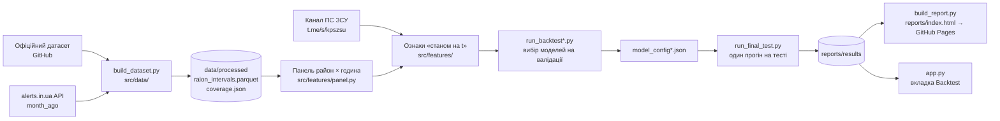

# Прогнозування повітряних тривог в Україні: як працює проєкт

Детальний опис роботи проєкту [Analysis-of-air-raid-alerts](https://github.com/itpsychologist/Analysis-of-air-raid-alerts): звідки беруться дані, як вони обробляються, як будуються ознаки, як навчаються й оцінюються моделі і як результати потрапляють у звіт і дашборд. Фрагменти коду взято з репозиторію; скорочені місця позначено `# ...`, а коментарі українською — пояснення, додані в цьому документі (у коді коментарі англійською).

> ⚠️ Прогнози аналітичні й побудовані з публічних даних. Вони **не замінюють офіційні сигнали тривоги**.

**Посилання:** [статичний звіт](https://itpsychologist.github.io/Analysis-of-air-raid-alerts/) · [дашборд](https://analysis-of-air-raid-alerts-kpetxtqhtsiwrspcccpfpt.streamlit.app/) · план (`PLAN.md`) · журнал роботи з AI (`AI_CONVERSATION_LOG.md`)

## Зміст

1. [Задача](#1-задача)
2. [Архітектура і пайплайн](#2-архітектура-і-пайплайн)
3. [Дані: джерела і знімки](#3-дані-джерела-і-знімки)
4. [Обробка даних: від подій до районних інтервалів](#4-обробка-даних-від-подій-до-районних-інтервалів)
5. [Погодинна панель і ціль A](#5-погодинна-панель-і-ціль-a)
6. [Ознаки «станом на t»](#6-ознаки-станом-на-t)
7. [Захист від витоку даних](#7-захист-від-витоку-даних)
8. [Моделі для цілі A](#8-моделі-для-цілі-a)
9. [Ціль B: добова кількість і тривалість](#9-ціль-b-добова-кількість-і-тривалість)
10. [Фінальний тест](#10-фінальний-тест)
11. [Результати](#11-результати)
12. [Звіт і дашборд](#12-звіт-і-дашборд)
13. [Обмеження](#13-обмеження)
14. [Як відтворити](#14-як-відтворити)

---

## 1. Задача

Прогноз робиться в **момент `t`** (forecast origin) для кожної з **119 одиниць**: 118 районів і м. Київ. Модель може використовувати лише те, що було відомо до `t`.

| Ціль | Питання | Горизонт | Тип |
|---|---|---|---|
| **A** (основна) | Чи **почнеться** тривога в районі протягом наступних `h` годин? | h = 1, 3, 6 год | бінарна класифікація, ймовірність |
| **B** | Скільки тривог і скільки годин під тривогою буде в районі за добу? | k = 1–7 днів | регресія лічильників |

**Чому райони, а не області.** З грудня 2025 тривоги оголошують переважно по районах. Якщо зводити їх до областей, прифронтові області «під тривогою» 95–100% часу, і прогнозувати там нічого. На рівні районів медіанна частка часу під тривогою 14–21%, тож задача має сенс для всієї країни.

**Головна вимога** — чесна оцінка без витоку даних (data leakage): жодна ознака в момент `t` не може залежати від того, що сталося після `t`. Цьому присвячено [розділ 7](#7-захист-від-витоку-даних).

---

## 2. Архітектура і пайплайн



```
├── app.py                 # Streamlit-дашборд (історія, прогноз, Backtest)
├── etl.py                 # живі дані alerts.in.ua для дашборду, районні тривоги
├── forecasting.py         # Holt-Winters / Ridge для дашборду
├── src/
│   ├── data/              # знімки джерел, нормалізація, склеювання, маска збоїв
│   ├── features/          # панель, ознаки as-of, ціль B, текстові ознаки, сусідство областей
│   ├── models/            # бейзлайни, logit / LightGBM / Poisson GLM, калібрування, conformal
│   ├── evaluation/        # хронологічні розбиття з ембарго, метрики, бутстрап
│   └── viz/               # спільні Plotly-графіки, завантаження результатів
├── scripts/               # CLI для кожного кроку
├── tests/                 # тести на витік і юніт-тести (119)
├── config/evaluation.json # заморожене вікно фінального тесту
└── reports/               # results/ (таблиці, конфігурації), index.html
```

---

## 3. Дані: джерела і знімки

| Джерело | Період | Роль |
|---|---|---|
| [Офіційний датасет](https://github.com/Vadimkin/ukrainian-air-raid-sirens-dataset), commit `bf0c323c78e3` | 15.03.2022 → 06.09.2026 | історія для навчання |
| alerts.in.ua API, `month_ago` по кожній області | 12.09 → 11.10.2026 | «хвіст» даних, на ньому фінальний тест |
| Пости каналу Повітряних сил (t.me/s/kpszsu) | 31.10.2025 → 11.10.2026 | текстові ознаки (абляція) |

**Знімки незмінні.** Кожне завантаження — новий файл з часом і commit-хешем у назві; старі ніколи не перезаписуються. Тому будь-який результат можна відтворити на тих самих даних, а новий знімок не зсуває заморожене тестове вікно.

```text
data/raw/github/official_data_uk/20261011T100347Z_bf0c323c78e3.csv.gz
data/raw/alerts_in_ua/20261011T100646Z/<uid>.json + manifest.json
data/raw/telegram/kpszsu/20261011T113920Z.jsonl.gz
```

**Що з'ясувалось на етапі EDA:**
- в офіційному CSV ≈⅓ рядків (113 845) — точні дублікати: історію 2022–2026 дописано двічі;
- 24 з 25 uid областей у старому `etl.py` були хибні — дашборд вантажив не ті області;
- частка часу під тривогою зросла з 13% (2022) до 40% (2026), а останній місяць — ескалація: ~481 районна тривога на добу проти ~312 у серпні. Тобто фінальний тест припадає на зміну режиму.

---

## 4. Обробка даних: від подій до районних інтервалів

### 4.1. Одна схема для всіх джерел

Кожне джерело зводиться до однакової таблиці подій (`src/data/merge.py`):

```text
oblast | raion | hromada | level | alert_type | started_at | finished_at | end_imputed | source
```

При цьому зводяться назви: різні апострофи (’ і ') та перейменування районів 2024 року.

```python
# Raions renamed in 2024: official dataset keeps old names, alerts.in.ua uses new ones
RAION_RENAMES = {
    "Володимир-Волинський район": "Володимирський район",
    "Красноградський район": "Берестинський район",
    "Червоноградський район": "Шептицький район",
}

# Permanent alert since 2022-04-04 (not listed in the datasets) — carries no signal
EXCLUDED_OBLASTS = {"Луганська область"}
```

### 4.2. Обласні тривоги → районні

До грудня 2025 тривогу оголошували на всю область, після — переважно на район. Щоб обидва режими давали одну ціль, обласна тривога копіюється на кожен район області:

```python
def expand_to_raions(events: pd.DataFrame, raion_map: dict[str, list[str]]) -> pd.DataFrame:
    """
    An oblast-level alert (the norm before Dec 2025) put every raion of the oblast
    under alert, so it is copied to each raion; a raion-level alert stays with its
    raion. Kyiv City has no raions in the data and is kept as a single unit.
    Hromada-level alerts are ignored.
    """
    ev = events[~events["oblast"].isin(EXCLUDED_OBLASTS)]
    raion_ev = ev[ev["level"] == "raion"].assign(unit=lambda d: d["raion"])
    oblast_ev = ev[ev["level"] == "oblast"]
    units = pd.DataFrame(
        [(ob, r) for ob, rs in raion_map.items() for r in rs], columns=["oblast", "unit"]
    )
    broadcast = oblast_ev.merge(units, on="oblast", how="left")
    broadcast["unit"] = broadcast["unit"].fillna(broadcast["oblast"])  # e.g. м. Київ
    # ...
```

### 4.3. Злиття перекриттів

Обласна і районна тривога можуть накладатися. Інтервали одного району зливаються в неперекривні:

```python
def union_intervals(df, key, open_until=None):
    """Merge overlapping [started_at, finished_at] intervals within each `key` group."""
    df = df.copy()
    if open_until is not None:
        df["finished_at"] = df["finished_at"].fillna(open_until)  # відкриті — до cutoff, не до «зараз»
    # ...
    # A new interval starts where started_at exceeds the running max end so far
    running_end = df.groupby(key)["finished_at"].cummax()
    prev_end = running_end.groupby(df[key]).shift()
    group = (df["started_at"] > prev_end) | prev_end.isna()
    df["grp"] = group.groupby(df[key]).cumsum()
    merged = df.groupby([key, "grp"]).agg(
        started_at=("started_at", "min"), finished_at=("finished_at", "max"),
        n_events=("started_at", "size"),
    )
```

Тривоги, що ще тривають на момент завантаження, закриваються **моментом відсічення даних**, а не «зараз». Інакше тривалість залежала б від того, коли запущено скрипт.

### 4.4. Склеювання джерел за часом і маска збоїв

Джерела не змішуються в один період: кожне відповідає за своє часове вікно (`src/data/build.py`).

```text
official dataset   [перший запис,  official_end)   мінус збої джерела
(gap — no data)    [official_end,  api_start)
alerts.in.ua API   [api_start,     api_fetched_at)
```

Офіційний потік записує тривогу лише після її завершення. Тож останні 24 год перед обривом вважаються непокритими: тривоги, що тривали в момент обриву, там просто відсутні.

**Збій джерела.** На етапі 5 знайшлося 105 годин (29.08 04:55 → 02.09 13:48), коли в офіційних даних немає **жодного** початку тривоги по всій країні. Найдовше справжнє затишшя за 2022–2026 — 30 год, а обласні тривоги Донеччини в ці дні «тривали» по 115 год. Це обрив потоку, а не тиша. Правило:

```python
OUTAGE_MIN_GAP = pd.Timedelta(hours=48)


def find_outages(starts: pd.Series, min_gap: pd.Timedelta = OUTAGE_MIN_GAP):
    """(last start before, first start after) for every national gap between alert starts > min_gap."""
    t = starts.drop_duplicates().sort_values().reset_index(drop=True)
    gap = t.diff()
    return [(t[i - 1], t[i]) for i in gap.index[gap > min_gap]]
```

Такий проміжок стає вікном типу `gap`: його години не є ні навчальними даними, ні мітками «тривоги не було». Результат — `coverage.json`:

```json
[
  {"source": "official", "start": "2022-03-15T16:10:34+00:00", "end": "2026-08-29T04:55:28+00:00"},
  {"source": "gap", "reason": "source outage", "start": "2026-08-29T04:55:28+00:00", "end": "2026-09-02T13:48:04+00:00"},
  {"source": "official", "start": "2026-09-02T13:48:04+00:00", "end": "2026-09-06T05:28:22+00:00"},
  {"source": "gap", "reason": "between sources", "start": "2026-09-06T05:28:22+00:00", "end": "2026-09-12T00:00:00+00:00"},
  {"source": "alerts_in_ua", "start": "2026-09-12T00:00:00+00:00", "end": "2026-10-11T10:06:46.909293+00:00"}
]
```

Підсумок обробки: **465 595 неперекривних інтервалів** для 119 одиниць, 15.03.2022 → 11.10.2026.

---

## 5. Погодинна панель і ціль A

Інтервали перетворюються на широкі матриці «година UTC × район» (`src/features/panel.py`):

| Матриця | Значення |
|---|---|
| `starts` | кількість **початків** тривоги в годині |
| `active_minutes` | хвилин під тривогою в годині |
| `covered` | чи вся година лежить усередині вікна якогось джерела |
| `active_at` | чи район під тривогою **рівно в момент** `t` (почалась до `t`, ще не скінчилась) |

Важлива деталь: інтервал, що починається рівно на межі вікна джерела, обрізаний склеюванням. Його «початок» — артефакт, і як новий старт тривоги він не рахується.

```python
# An interval that begins exactly at a source-window start was clipped there;
# its start is an artefact of stitching, not a real calm -> alert transition.
window_starts = {pd.Timestamp(w["start"]) for w in windows if w["source"] != "gap"}
real = intervals[~intervals["started_at"].isin(window_starts)]
```

**Мітка цілі A** для моменту `t` і горизонту `h`: 1, якщо в `[t, t+h)` почалась тривога; 0, якщо ні; NaN, якщо хоч одна година вікна не покрита даними.

```python
def labels(panel: Panel, h: int) -> pd.DataFrame:
    starts = panel.starts.to_numpy()
    covered = panel.covered.to_numpy().astype(float)
    n = len(starts)
    csum = np.vstack([np.zeros((1, starts.shape[1])), np.cumsum(starts, axis=0)])
    ccov = np.concatenate([[0.0], np.cumsum(covered)])

    y = np.full(starts.shape, np.nan)
    t = np.arange(n - h + 1)
    window_starts = csum[t + h] - csum[t]
    fully_covered = (ccov[t + h] - ccov[t]) == h
    y[t] = np.where(fully_covered[:, None], (window_starts > 0).astype(float), np.nan)
    return pd.DataFrame(y, index=panel.hours, columns=panel.units)
```

Ключове правило, з якого випливає решта захисту від витоку: **мітка моменту `t′` стає відомою лише в `t′ + h`.** Отже, будь-яка ознака в `t` може використовувати лише мітки з `t′ + h ≤ t`.

---

## 6. Ознаки «станом на t»

Кожна ознака — матриця «момент `t` × район», і її рядок `t` читає лише:
- години **строго до** `t`;
- стан «тривога триває в `t`» (`active_at`);
- мітки з `t′ + h ≤ t`;
- календар моменту `t` (він відомий наперед).

### 6.1. Історія району, сусіди, країна

Усе будується через одну функцію `before()`: рядок `t` отримує годину `t−1`, а якщо та година не покрита даними — NaN, не нуль.

```python
def history_features(panel: Panel, unit_oblast: dict[str, str]) -> dict[str, pd.DataFrame]:
    cov = panel.covered.to_numpy()
    cov_before = np.concatenate([[False], cov[:-1]])  # row t: was hour t-1 covered?

    def before(x: np.ndarray) -> np.ndarray:
        """Row t <- hour t-1, NaN where that hour was not covered."""
        shifted = np.vstack([np.full((1, x.shape[1]), np.nan), x[:-1]])
        return np.where(cov_before[:, None], shifted, np.nan)

    starts = before(panel.starts.to_numpy())
    active = before(panel.active_minutes.to_numpy() / 60)
    now = np.where(cov_before[:, None], panel.active_at.to_numpy(), np.nan)

    same, nbr = group_matrices(units, unit_oblast)
    f = {
        "unit_active_now": now,
        "unit_starts_1h": starts,
        "unit_active_1h": active,
        "unit_since_start": _hours_since(np.nan_to_num(starts) > 0, cov_before),
        "unit_since_alert": _hours_since(np.nan_to_num(active) > 0, cov_before),
    }
    for w in UNIT_WINDOWS:                       # 3, 6, 24, 168 год
        f[f"unit_starts_{w}h"] = _rolling_mean(starts, w)
        f[f"unit_active_{w}h"] = _rolling_mean(active, w)

    # Spatial: same oblast, bordering oblasts, whole country
    for name, agg in [("oblast", lambda x: x @ same.T), ("nbr", lambda x: x @ nbr.T), ("country", _country_mean)]:
        f[f"{name}_active_now"] = agg(now)
        for w in SPATIAL_WINDOWS:                # 1, 3 год
            f[f"{name}_starts_{w}h"] = agg(_rolling_mean(starts, w))
            f[f"{name}_active_{w}h"] = agg(_rolling_mean(active, w))
    # Intensity regime ("massive phase") over the last day and week
    for w in (24, 168):
        f[f"country_starts_{w}h"] = _country_mean(_rolling_mean(starts, w))
        f[f"country_active_{w}h"] = _country_mean(_rolling_mean(active, w))
    # ...
```

**Просторові ознаки** потребують сусідства областей. Матрицю кордонів записано вручну (`src/features/geo.py`), а з неї будуються нормовані матриці: множення `X @ M.T` дає середнє `X` по своїй області або по сусідніх.

```python
_BORDERS = {
    "Вінницька область": ["Житомирська область", "Київська область", "Черкаська область",
                          "Кіровоградська область", "Одеська область", "Хмельницька область",
                          "Чернівецька область"],
    "Сумська область": ["Чернігівська область", "Харківська область"],
    # ...
}
```

**Календар** — київський час (з урахуванням переходу на літній/зимовий), закодований синусом і косинусом:

```python
def calendar(hours: pd.DatetimeIndex) -> pd.DataFrame:
    local = hours.tz_convert(KYIV_TZ)
    hour, dow = local.hour.to_numpy(), local.dayofweek.to_numpy()
    return pd.DataFrame({
        "hour_sin": np.sin(2 * np.pi * hour / 24),
        "hour_cos": np.cos(2 * np.pi * hour / 24),
        "dow_sin": np.sin(2 * np.pi * dow / 7),
        "dow_cos": np.cos(2 * np.pi * dow / 7),
        "is_night": ((hour >= 22) | (hour < 6)).astype(float),
    }, index=hours)
```

### 6.2. Ознаки з минулих міток

Частоти тривог за минулі дні — це ті самі бейзлайни (розділ 8.1), які вже зсунуто щонайменше на `h`:

```python
def label_features(Y: pd.DataFrame, h: int) -> dict[str, pd.DataFrame]:
    """Past label rates for horizon h (the baselines; each shifts labels by >= h rows)."""
    return {
        "rate_recent_24h": recent_rate(Y, h),
        "rate_unit_28d": unit_rate(Y, h),
        "rate_hour_of_day_28d": hour_of_day_rate(Y, h),
    }
```

### 6.3. Текстові ознаки (етап 4)

Пости каналу Повітряних сил розмічаються регулярними виразами (`src/features/text.py`): категорії загроз, згадки областей і міст (з відмінками) і кількість запущених БпЛА та ракет з ранкового звіту.

```python
CATEGORIES = {
    "drone": r"бпла|шахед|дрон|🛵|мопед",
    "jet_drone": r"реактивн",
    "ballistic": r"балістик|балістичн",
    "missile": r"ракет|крилат|калібр|х-101|х-22|х-59|х-69|🚀|швидкісн",
    "kab": r"\bкаб|💣",
    "aviation": r"ту-95|ту-160|ту-22|міг-31|зліт|борт|авіаці",
    "threat": r"загроз",
}

# Кількість запущених — лише з речення «противник атакував ...»
REPORT_ATTACK = re.compile(r"противник атакува\w*(.*?)(?:\bіз напрямк|\bз напрямк|\n\n|$)", re.S)
REPORT_DRONES = re.compile(r"(\d+)\s+(?:[\w-]+\s+){0,2}(?:бпла|безпілотн\w*|шахед\w*|дрон\w*)")
```

Пост видимий у момент `t`, лише якщо `date_utc < t`. Дати, згадані в тексті, ігноруються. Є тонкий момент з **відредагованими постами**: превʼю показує текст після редагування, яке могло статися пізніше за `t`. Тому такі пости лишаються (інакше сама їхня присутність залежала б від майбутнього), але всі ознаки з їхнього тексту — NaN.

```python
if "edited" in messages:
    content = [c for c in out.columns if c not in ("date_utc", "cat_posts", "is_report")]
    out.loc[messages["edited"].astype(bool).to_numpy(), content] = np.nan
```

Правила розмітки заморожено перед фінальним тестом: sha256 файлу `text.py` записано в `model_config.json`, і фінальний прогін перевіряє, що хеш не змінився.

### 6.4. Від матриць до таблиці для моделі

Широкі матриці розгортаються в довгу таблицю: один рядок — пара (момент, район).

```python
def stack(features: dict[str, pd.DataFrame], rows: np.ndarray) -> pd.DataFrame:
    first = next(iter(features.values()))
    index = pd.MultiIndex.from_product([first.index[rows], first.columns], names=["origin", "unit"])
    return pd.DataFrame(
        {k: v.to_numpy()[rows].ravel().astype(np.float32) for k, v in features.items()}, index=index
    )
```

---

## 7. Захист від витоку даних

### 7.1. Правила

1. Ознаки в `t` будуються лише з подій, що почалися до `t`.
2. Тривалість тривоги, яка ще триває в `t`, невідома: вона обрізається моментом `t`, а «триває зараз» — окремий прапорець.
3. Усі ковзні вікна закінчуються строго до `t`.
4. Імпутація, нормалізація та інші статистики рахуються лише на навчальній частині кожного розбиття.
5. Жодного випадкового `train_test_split` — лише хронологічне розбиття.
6. Налаштування вибираються на валідації, що передує тесту. Фінальний тест відкривається **один раз**.
7. Між навчанням і оцінкою — ембарго `h` годин.

### 7.2. Розбиття з ембарго

```text
... | fold 1 | ... | fold 6 | validation | (gap) | final test |
                                                   ^ останні 28 днів даних
```

Навчальні моменти для розбиття, що починається в `S`, обмежені умовою `t + h ≤ S − h`: жодне вікно мітки навчання не підходить до оцінюваного періоду ближче, ніж на `h` годин.

```python
@dataclass(frozen=True)
class Split:
    name: str
    start: pd.Timestamp  # first origin (inclusive)
    end: pd.Timestamp  # last origin (exclusive)

    def train_end(self, h: int, embargo_hours: int | None = None) -> pd.Timestamp:
        """
        Exclusive upper bound for training origins: t + h <= start - embargo, so
        no training label window comes within `embargo` hours of the split.
        """
        embargo = h if embargo_hours is None else embargo_hours
        return self.start - pd.Timedelta(hours=h + embargo - 1)
```

Валідація не може містити непокритих годин: якщо в її вікні є прогалина, вона зсувається так, щоб закінчитися перед прогалиною. Через це після виявлення збою джерела валідація перемістилась на **01.08–29.08.2026**, а фолди — на 20.06–01.08.

**Фінальний тест заморожено** в `config/evaluation.json`: 13.09–11.10.2026. Новий знімок даних його не зсуває.

```json
{
  "frozen_on": "2026-10-11",
  "test_start": "2026-09-13T10:00:00+00:00",
  "test_end": "2026-10-11T10:00:00+00:00",
  "data_cutoff": "2026-10-11T10:06:46.909293+00:00",
  "snapshots": {"official_data_uk": "20261011T100347Z_bf0c323c78e3.csv.gz", "alerts_in_ua": "20261011T100646Z"}
}
```

### 7.3. Тест «збурення майбутнього»

Головний доказ відсутності витоку. Беремо момент `t`, випадково переписуємо **все**, що невідоме в `t` (кінці тривог, що тривають, і всі тривоги після `t`), перебудовуємо дані з нуля і перевіряємо, що **кожна** ознака в `t` не змінилась:

```python
def perturb_future(iv: pd.DataFrame, t: pd.Timestamp, seed: int) -> pd.DataFrame:
    """
    Rewrite everything that is unknown at t: alerts running at t get a random end
    (still after t), alerts starting at or after t are replaced by random new ones.
    """
    rng = np.random.default_rng(seed)
    past = iv[iv["started_at"] < t].copy()
    running = past["finished_at"] > t
    past.loc[running, "finished_at"] = t + pd.to_timedelta(rng.integers(1, 2000, running.sum()), unit="min")
    new = random_intervals(seed + 100, start=t, end=T("2025-11-05"))
    # ...


@pytest.mark.parametrize("h", [1, 3, 6])
def test_features_at_t_ignore_everything_after_t(h):
    iv = boundary_intervals()
    panel = build_panel(iv, COVERAGE)
    F = build_features(panel, UNIT_OBLAST, labels(panel, h), h)
    for i, t in enumerate(ORIGINS):              # межі вікон, перші години після прогалини, перехід часу
        for seed in (i, i + 50):
            p2 = build_panel(perturb_future(iv, t, seed=seed), COVERAGE)
            F2 = build_features(p2, UNIT_OBLAST, labels(p2, h), h)
            for name in F:
                pd.testing.assert_series_equal(F[name].loc[t], F2[name].loc[t], obj=f"{name} h={h} at {t}")
```

Тести на витік (цей і тести бейзлайнів у `tests/test_leakage.py`) перевірено **мутаціями**: якщо навмисно зсунути мітки на `h−1` замість `h` або групувати бейзлайн за київською годиною, вони падають. Друга мутація вказала на реальний витік на осінньому переході часу: одна київська година трапляється двічі з різницею в годину, і «та сама година вчора» могла бути ще невідомою міткою. Тому бейзлайни тепер використовують точні 24-годинні зсуви (розділ 8.1).

Окремі тести перевіряють, що бейзлайни не читають ще невідомі мітки, розбиття впорядковані й мають ембарго, текстові ознаки бачать лише пости з `date_utc < t`, а заморожене тестове вікно не рухається з новими даними. Перед відкриттям тесту окремий субагент-аудитор двічі перевіряв код лише на читання; витоку не знайдено, а всі його зауваження виправлено до прогону.

---

## 8. Моделі для цілі A

### 8.1. Бейзлайни

Будь-яка модель мусить їх перемогти. Кожен бейзлайн зсуває мітки щонайменше на `h` рядків (`src/models/baselines.py`):

```python
def unit_rate(Y: pd.DataFrame, h: int, window_days: int = 28) -> pd.DataFrame:
    """Per-unit share of positive labels over the last `window_days` days."""
    w = window_days * 24
    return Y.shift(h).rolling(w, min_periods=w // 2).mean()


def hour_of_day_rate(Y: pd.DataFrame, h: int, window_days: int = 28) -> pd.DataFrame:
    """
    Uses exact 24-hour lags of the regular hourly index rather than grouping by
    local Kyiv hour: on the autumn DST change a local hour occurs twice, one hour
    apart, and a "previous same hour" could then be a label not yet known at t.
    """
    first_lag = math.ceil(h / 24)
    lags = [Y.shift(24 * k) for k in range(first_lag, first_lag + window_days)]
    total = sum(lag.fillna(0.0) for lag in lags)
    count = sum(lag.notna().astype(float) for lag in lags)
    return (total / count).where(count >= window_days // 2)
```

| Бейзлайн | Що прогнозує |
|---|---|
| `unit_rate_28d` | частку годин з початком тривоги в районі за 28 днів (**еталон** для Brier skill score) |
| `hour_of_day_rate_28d` | те саме, але лише для тієї ж години доби |
| `recent_rate_24h` | частку за останню добу («persistence») |
| `seasonal_naive` | «як тиждень тому в цю ж годину» |

### 8.2. Логістична регресія і LightGBM

Імпутація і масштабування навчаються лише на навчальних рядках кожного розбиття, бо стоять усередині pipeline:

```python
def make_logit(C: float = 1.0):
    """Logistic regression: median imputation + missing flags, standardised features."""
    return make_pipeline(
        SimpleImputer(strategy="median", add_indicator=True),
        StandardScaler(),
        LogisticRegression(C=C, max_iter=1000),
    )
```

LightGBM — з дуже простими деревами: великі дерева «запам'ятовують» частоту району і гірше вгадують **час** тривоги.

```python
params = {
    "objective": "binary",
    "learning_rate": 0.05,
    "num_leaves": 15,              # на валідації вибрано 7 (h = 1) і 15 (h = 3, 6)
    "min_child_samples": 3000,
    "subsample": 0.8, "subsample_freq": 1, "colsample_bytree": 0.8,
    "reg_lambda": 1.0,
    "random_state": SEED, "deterministic": True, "force_row_wise": True,
}
```

**Вікно навчання** теж налаштовується, бо тактика атак змінюється і стара історія може шкодити. Модель для розбиття навчається лише на моментах до `train_end(h)` і в межах останніх `window_days` днів:

```python
def train_rows(hours: pd.DatetimeIndex, split: Split, h: int, window_days: int) -> np.ndarray:
    """Origin rows a model for `split` may be trained on."""
    end = split.train_end(h)
    return (hours < end) & (hours >= end - pd.Timedelta(days=window_days))
```

### 8.3. Вибір налаштувань і калібрування

`scripts/run_backtest.py` перебирає вікно навчання (60/90/180/365 днів) і розмір дерев, а кількість дерев визначає ранньою зупинкою — **лише на валідації**. Вибране записується в `model_config.json`:

| h | LightGBM | Логістична регресія |
|---|---|---|
| 1 | вікно 180 днів, 7 листків, 379 дерев | 180 днів |
| 3 | 365 днів, 15 листків, 196 дерев | 90 днів |
| 6 | 365 днів, 15 листків, 235 дерев | 180 днів |

Валідаційні числа моделей тому оптимістичні. Фолди теж перевикористовують ці налаштування, тож **незміщена оцінка — лише фінальний тест**.

Калібрування (Platt та isotonic, навчені на прогнозах фолдів) на валідації Brier не покращило: прогнози LightGBM уже відкалібровані, тож у фінальний прогін калібратор не пішов.

**Найважливіші ознаки** LightGBM (частка gain, h = 1): частота району за 28 днів (17%) і для тієї ж години (14%), активність району за тиждень (12%), «тривога зараз» (12%) і за добу (7%), тривоги в сусідніх областях зараз (4%), активність по країні.

---

## 9. Ціль B: добова кількість і тривалість

### 9.1. Добова панель

Доба — **київська** (23 або 25 годин у дні переходу часу), будується з погодинної панелі, тож правила проти витоку переносяться автоматично. Доба вважається покритою, лише якщо покрита кожна її година.

Прогноз робиться опівночі дня `d` на дні `D = d + k − 1`. Ознаки цільового дня `D` для горизонту `k` беруться з моменту `D − k + 1`:

```python
def for_horizon(F: dict[str, pd.DataFrame], daily: DailyPanel, k: int) -> dict[str, pd.DataFrame]:
    """Design matrices indexed by target day D for horizon k (origin D - k + 1)."""
    out = {name: m.shift(k - 1) for name, m in F.items()}
    for target in TARGETS:
        out[f"{target}_same_dow"] = daily.target(target).shift(7)  # day D - 7 <= origin - 1
    # ... + календар дня D
    return out
```

Модель, оцінювана з дня `S`, навчається лише на цільових днях `≤ S − k`: рівно на тих мітках, що відомі в першому моменті прогнозу.

```python
def train_end(self, k: int) -> pd.Timestamp:
    """Exclusive bound on training target days: D <= start - k (known at the first origin)."""
    return self.start - pd.Timedelta(days=k - 1)
```

### 9.2. Моделі

- **Бейзлайни:** `mean_28d`, `mean_7d`, `last_day`, `seasonal_naive` («той самий день тиждень тому» — знаменник MASE).
- **Holt-Winters з дашборду**, переобучений у кожному моменті прогнозу на останніх 56 днях — щоб чесно оцінити саме ту модель, яку бачать користувачі.
- **Poisson GLM** і **LightGBM** з Poisson-цільовою функцією.
- **Інтервали:** квантильні моделі LightGBM (2.5%, 10%, 90%, 97.5%), розширені **split-conformal** поправкою, навченою на позавибіркових інтервалах валідації (CQR):

```python
def conformal_margin(y, lower, upper, level: float) -> float:
    """
    Split-conformal widening of a quantile interval (CQR, Romano et al. 2019).
    Fit on out-of-sample intervals of a calibration period: [lower - m, upper + m]
    covers a new exchangeable point with probability >= level.
    """
    scores = np.maximum(lower - y, y - upper)
    n = len(scores)
    q = min(1.0, np.ceil((n + 1) * level) / n)
    return float(np.quantile(scores, q, method="higher"))
```

---

## 10. Фінальний тест

`scripts/run_final_test.py` нічого не вибирає: кожна модель бере налаштування з `model_config*.json` і навчається точно так, як у бектесті, з тестом як розбиттям. Захисти:

| Ризик | Захист |
|---|---|
| тест відкрито кілька разів | маркер `final_test.json` пишеться зі статусом `opened` **до** підрахунку; повторний запуск відмовляє |
| записаний коміт не відповідає коду | запуск лише без незакомічених змін у `src/`, `scripts/`, `config/` |
| налаштування вибрано на іншій збірці даних | sha256 вікон покриття в конфігураціях звіряється з поточними даними |
| змінено правила розмітки тексту | sha256 `text.py` звіряється із замороженим |
| збій API в тестовому вікні | те саме правило > 48 год без стартів, перевірене до підрахунку |
| бейзлайн не визначений на частині тесту | модель оцінюється на **всіх** клітинках; такий бейзлайн — на своїй підмножині з власним `n`, а не «звужує» оцінку моделей |

Перш ніж відкривати тест, увесь конвеєр проганяється в режимі **репетиції** (`--rehearse`): замість тесту береться вікно валідації. Для `h = 1` репетиція відтворила валідаційні рядки `backtest.csv` **з точністю до 0.0**, тобто код фінального тесту збігається з кодом бектесту.

**Значущість** — бутстрап, що перевибирає **цілі київські доби** (години в межах доби сильно залежні; блоки по 3 доби дають ту саму картину):

```python
def bootstrap_skill(loss, loss_ref, n_boot=2000, level=0.95, seed=0) -> dict[str, float]:
    """
    Skill 1 - sum(loss) / sum(loss_ref) with a block-bootstrap interval.
    `loss` and `loss_ref` are per-block sums over the same cells, so blocks (days) are resampled whole.
    """
    rng = np.random.default_rng(seed)
    idx = rng.integers(0, len(loss), size=(n_boot, len(loss)))
    boot = 1 - loss[idx].sum(axis=1) / loss_ref[idx].sum(axis=1)
    a = (1 - level) / 2
    return {
        "skill": float(1 - loss.sum() / loss_ref.sum()),
        "ci_low": float(np.quantile(boot, a)),
        "ci_high": float(np.quantile(boot, 1 - a)),
        "share_not_better": float(np.mean(boot <= 0)),
        "n_blocks": int(len(loss)),
    }
```

---

## 11. Результати

Фінальний тест 13.09–11.10.2026, близько 80 000 клітинок «район × година» на горизонт. BSS — Brier skill score відносно частоти району за 28 днів (більше — краще, 0 — рівно як еталон).

### Ціль A: чи почнеться тривога

| h | Базова частота | LightGBM BSS [95% ДІ] | Логістична регресія | AUC всередині району: LightGBM / еталон | PR-AUC: LightGBM / еталон | LightGBM у бектесті (фолди / валідація) |
|---|---|---|---|---|---|---|
| 1 год | 0.16 | **+0.113** [+0.098, +0.126] | +0.096 | 0.68 / 0.46 | 0.49 / 0.32 | +0.103 / +0.100 |
| 3 год | 0.37 | **+0.070** [+0.054, +0.086] | +0.048 | 0.64 / 0.46 | 0.74 / 0.67 | +0.076 / +0.065 |
| 6 год | 0.52 | **+0.042** [+0.022, +0.061] | +0.038 | 0.63 / 0.43 | 0.87 / 0.84 | +0.030 / +0.042 |

- **Моделі перемагають усі бейзлайни на всіх горизонтах**, і тест підтверджує бектест. LightGBM краща за логістичну регресію при h = 1 і 3 (значуще), при h = 6 вони рівні.
- **AUC всередині району** — ключова метрика. Загальний ROC-AUC високий навіть у бейзлайнів, бо фронт відрізняється від заходу. А всередині району частота за 28 днів не розрізняє години зовсім (≈0.45), тоді як модель досягає 0.63–0.68, тобто вгадує **час**.
- **Калібрування:** середній розрив між прогнозом і спостереженою частотою 1–2 п.п. Тестовий місяць був інтенсивнішим за валідацію (база 0.16 проти 0.12), тому при h = 1 високі ймовірності трохи занижені.
- **За областями:** найбільший виграш у Запорізькій і Донецькій (BSS ≈ +0.33…+0.35 при h = 1). На заході (Закарпатська, Львівська, Івано-Франківська, база < 1%) модель трохи гірша за частоту району (−0.03…−0.04).
- **Текст не допоміг:** зміна Brier від текстових ознак −0.001 [−0.007, +0.004] при h = 1. Пост «БпЛА курсом на …» з'являється тоді ж, коли оголошують тривогу, а тривоги в сусідніх областях уже є серед ознак.

### Ціль B: добова кількість тривог у районі

MASE відносно «того самого дня тиждень тому» (менше — краще), на днях, де визначені всі прогнози:

| Модель | k = 1 | k = 7 |
|---|---|---|
| **Середнє за 28 днів** | **0.73** | **0.77** |
| Poisson GLM | 0.73 | 0.85 |
| LightGBM (Poisson) | 0.77 | 0.80 |
| Holt-Winters (дашборд) | 0.91 | 1.61 |

- **Найкращий прогноз — просте 28-денне середнє**: добова кількість тривог шумна, і минуле середнє вже містить майже всю передбачувану частину.
- **Holt-Winters з дашборду** на 31% гірший за середнє при k = 1 і вдвічі гірший при k = 7. Його «95%» інтервал покриває лише 54–66% випадків.
- **Conformal-поправка** покращує покриття квантильних інтервалів (80% → 69–76%, 95% → 82–92%), але на тесті вони все одно вужчі за номінал: тестовий місяць поводився інакше, ніж валідаційний.

---

## 12. Звіт і дашборд

### 12.1. Спільні графіки

Усі Plotly-графіки живуть у `src/viz/charts.py` без жодного імпорту Streamlit, тож **ті самі** функції малюють і дашборд, і статичний звіт. Тема (`dark` / `light`) — параметр.

### 12.2. Статичний звіт

`scripts/build_report.py` читає лише збережені результати з `reports/results/` і не звертається ні до API, ні до моделей. Plotly.js вбудовується в сторінку один раз, тож `reports/index.html` (~7.6 МБ) працює офлайн, має світлу й темну тему і мобільну верстку. Тест перевіряє, що HTML валідний і не тягне зовнішніх скриптів. Workflow `.github/workflows/pages.yml` публікує на GitHub Pages **лише** цей файл.

### 12.3. Дашборд

**Районні тривоги в живих даних.** Дашборд спершу рахував лише записи `location_type == "oblast"` і за 30 днів бачив 219 тривог у 3 областях замість ~14 500 районних тривог у 24 областях. Тепер `etl.raion_alerts` повторює логіку дослідження на живих даних API:

```python
def raion_alerts(df, as_of=None, by_type=False) -> pd.DataFrame:
    """Raw API records -> one row per raion alert, in the columns the aggregates use."""
    from src.data.merge import RAION_RENAMES, expand_to_raions, union_intervals

    ev = df[df["location_type"].isin(["oblast", "raion"])]          # громади й міста не рахуються
    raion_name = (ev["location_title"].astype("string").str.replace("’", "'", regex=False)
                  .replace(RAION_RENAMES))
    events = pd.DataFrame({
        "oblast": ev["location_oblast"],
        "raion": raion_name.where(ev["location_type"] == "raion"),
        "level": ev["location_type"],
        "started_at": pd.to_datetime(ev["started_at"], utc=True),
        "finished_at": pd.to_datetime(ev["finished_at"], utc=True),
        "type": ev["alert_type_en"] if by_type else "any",
    })
    raion_map = {ob: list(rs) for ob, rs in raion_units().items()}   # src/data/raion_units.json
    # ...
    units = pd.concat(parts, ignore_index=True)                      # expand_to_raions по кожному типу
    merged = union_intervals(units[["key", "started_at", "finished_at"]], "key", open_until=as_of)
    # ...
```

Рейтинг вразливості тепер рахується **на район**, щоб великі області не мали переваги: 60% — кількість тривог на район, 40% — частка часу під тривогою.

**Вкладка Backtest без очікування.** Історія з API вантажиться ~12 хвилин через ліміт 2 запити на хвилину. Щоб результати дослідження було видно одразу, вкладки створюються і Backtest рендериться **до** перевірки токена й завантаження:

```python
status = st.container()  # loading message / errors
kpi_area = st.container()
tab_hist, tab_forecast, tab_backtest = st.tabs([...])
with tab_backtest:
    render_backtest_tab()          # лише reports/results, без API

api_token = get_api_token()
# ... далі — завантаження історії і решта вкладок
```

Усередині Backtest перемикачі горизонту й цілі зроблено вкладеними `st.tabs`, а не віджетами. Експеримент показав, що клік звичайного віджета під час довгого прогону перериває скрипт і запускає його заново, а з ним і завантаження історії. Вкладки ж перемикаються в браузері без перезапуску.

---

## 13. Обмеження

- **Один тестовий місяць**, до того ж на зміні режиму (ескалація у вересні–жовтні 2026). Це одна вибірка, а не гарантія.
- **Нестаціонарність:** система тривог і тактика атак змінюються. Вікно навчання — налаштування, тож стара історія або використовується повністю, або відкидається.
- **Прогалини даних:** «як тиждень тому» оцінюється лише з 19.09. Правило збоїв джерела національне, тож збій в одній області не буде виявлено.
- **Рідкісні райони:** на заході спільна модель трохи гірша за власну частоту району.
- **Масовані атаки** важко передбачити з історії тривог, а публічні пости на погодинному рівні нічого не додали.
- **Для тексту** правила розмітки спершу налаштовувались на текстах із вікна тесту (без міток тривог). Виграшу немає й так, тож можливий оптимізм нічого не змінює.

---

## 14. Як відтворити

```bash
uv venv --python python3.12 .venv && uv pip install --python .venv/bin/python -r requirements-dev.txt
.venv/bin/python scripts/fetch_data.py --api          # сирі знімки (API ~12 хв через ліміт)
.venv/bin/python scripts/fetch_telegram.py --since 2025-11-01   # опційно, текст (~1.5 год)
.venv/bin/python scripts/build_dataset.py             # data/raw -> data/processed
.venv/bin/python scripts/run_backtest.py              # ціль A: вибір моделей, фолди і валідація
.venv/bin/python scripts/run_backtest_daily.py        # ціль B
.venv/bin/python scripts/run_final_test.py --rehearse /tmp/rehearsal   # безпечна репетиція
.venv/bin/python scripts/build_report.py              # reports/results -> reports/index.html
.venv/bin/python -m pytest                            # 119 тестів, серед них тести на витік
```

Фінальний тест уже відкрито (11.10.2026), і `run_final_test.py` повторно не запуститься. Будь-яку зміну моделі тепер можна чесно оцінити лише на нових даних після cutoff 11.10.2026.
